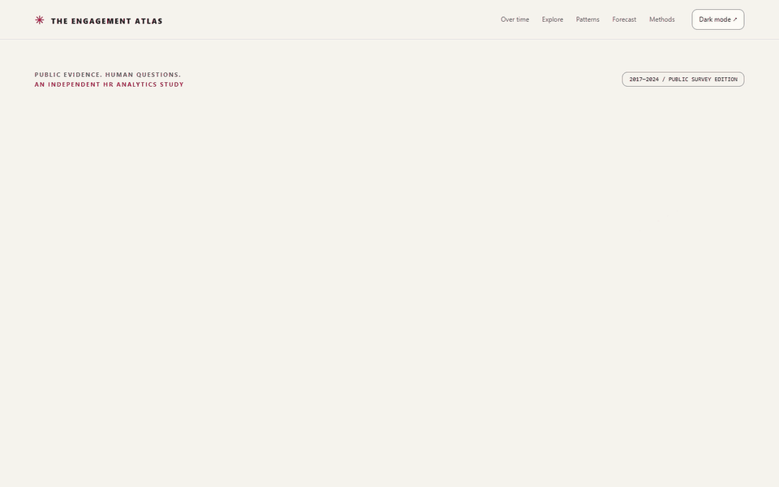
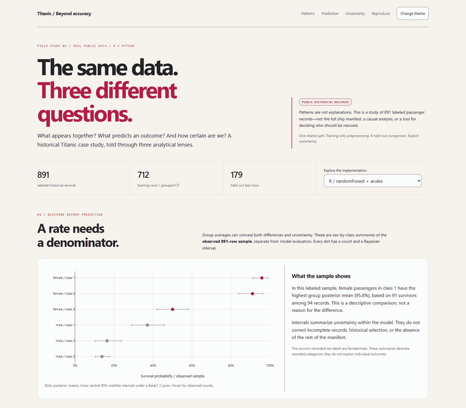
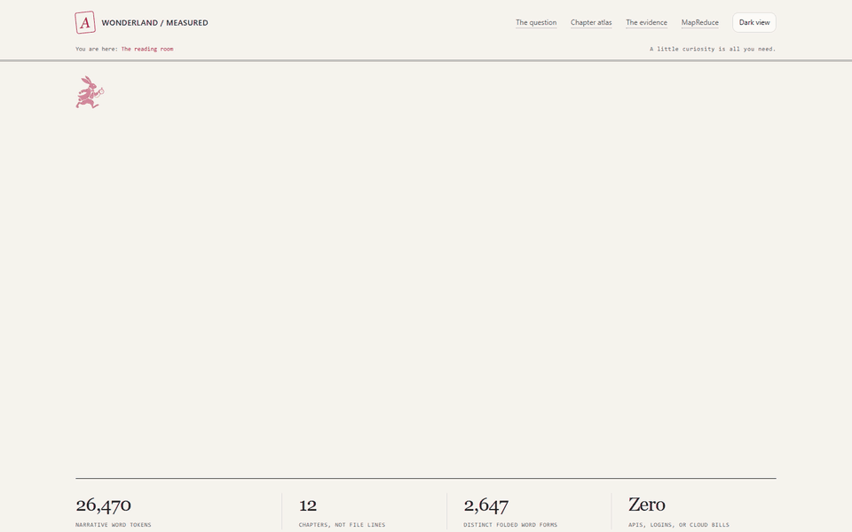

  <picture>
    <source media="(prefers-reduced-motion: reduce)" srcset="assets/profile-banner-static.svg">
    
  </picture>

# Margarita Bermejo Cano

<picture>
  <source media="(prefers-reduced-motion: reduce)" srcset="assets/headline-static.svg">
  
</picture>

**I turn people data into decisions leaders can trust.** 
**Open to:** People Analytics / People Science roles

**People Analytics · Applied Data Science · AI Readiness & Adoption**

I'm a People Science Analyst at Microsoft. I work with surveys, measurement
and mixed-methods research to understand employee experience and how people
work with AI. Before that, I worked in customer-facing people analytics at
LinkedIn Glint and regional workforce measurement at MetLife.

**R is my first choice. Curiosity is the constant.** I like following a question
through the data, checking what changes the answer, and finding a clear way
to share it.

**[Start here](#start-here)** · **[Research](#selected-research)** · **[Projects](#projects)** · **[Featured study](#featured-study)** · **[Worth a Look](#worth-a-look)** · **[Methods & code](#methods--code)** · **[Connect ↗](https://www.linkedin.com/in/margaritabermejocano/)**

## Start here

- **[The Engagement Atlas ↗](https://mberca.github.io/engagement-atlas/?utm_source=github&utm_medium=profile&utm_campaign=readme)**: 630 organization-year observations from the US Federal Employee Viewpoint Survey, comparing five machine-learning models with a simple forecast.
- **[Titanic / Patterns, Prediction & Uncertainty ↗](https://mberca.github.io/titanic-patterns/?utm_source=github&utm_medium=profile&utm_campaign=readme)**: one dataset, three methods (association rules, random forest, Bayesian intervals), in R and Python.
- **[Wonderland, Measured ↗](https://mberca.github.io/alice-in-wonderland-analysis/?utm_source=github&utm_medium=profile&utm_campaign=readme)**: a 2013/14 counting project revisited, showing how a counting rule can change the answer.
## Selected research

**[2025 Agentic Teaming & Trust Research Report ↗](https://techcommunity.microsoft.com/t5/s/gxcuf89792/attachments/gxcuf89792/MicrosoftVivaBlog/1027.2/1/2025%20Agentic%20Teaming%20%26%20Trust%20Research%20Report.pdf)** 
Co-author of the full report; lead analyst on the wider research programme.

**[The State of AI Change Readiness ↗](https://adoption.microsoft.com/files/viva/The-state-of-AI-change-readiness-eBook.pdf)** 
Co-author of the 2024 eBook on organisational AI readiness.

**[Early LLM-based tools and enterprise productivity ↗](https://www.microsoft.com/en-us/research/publication/early-llm-based-tools-for-enterprise-information-workers-likely-provide-meaningful-boosts-to-productivity/)** 
Co-author of the collaborative 2023 report; contributor to early-user survey analysis.

These are shared research contributions, distinct from the independent
public-data projects below.

## Projects

### The Engagement Atlas · Real HR evidence, human questions

  <a href="https://mberca.github.io/engagement-atlas/?utm_source=github&utm_medium=profile&utm_campaign=readme">
    <picture>
      <source media="(prefers-reduced-motion: reduce)" srcset="assets/engagement-atlas-still.png">
      
    </picture>
  </a>

**Work is a relationship. Can we see it changing?**

An independent HR analytics study of **630 public organization-year observations,
85 reporting agencies, and eight survey years** from the US Federal Employee
Viewpoint Survey. Real survey statistics, published at organization level—not
synthetic data or individual employee records.

Follow engagement trajectories, explore experience profiles, and compare five
advanced machine-learning models with a simple forecast. The interesting question
isn't just what predicts engagement: it's whether complexity earns its place,
and whether a convincing "driver" is actually part of the measurement itself.

Interactive visual storytelling, an executed analytical notebook, temporal
validation, uncertainty, and transparent sources. Stated intention to leave
is distinguished from actual turnover; associations are not causal effects.

**[Explore the atlas ↗](https://mberca.github.io/engagement-atlas/?utm_source=github&utm_medium=profile&utm_campaign=readme)** ·
[Code & notebook](https://github.com/mberca/engagement-atlas) ·
[Methods](https://github.com/mberca/engagement-atlas/blob/main/METHODOLOGY.md)

## Featured study

An independent study using public historical data, with reproducible R and
Python editions.

### Titanic / Patterns, Prediction & Uncertainty

  <a href="https://mberca.github.io/titanic-patterns/?utm_source=github&utm_medium=profile&utm_campaign=readme">
    <picture>
      <source media="(prefers-reduced-motion: reduce)" srcset="assets/titanic-still.png">
      
    </picture>
  </a>

**One dataset. Three ways to ask a question.**

Which patterns appear together? What helps predict survival? How uncertain are
the group estimates? I explore these questions with association rules, a random
forest, and Bayesian analysis in **R and Python**.

The study uses a documented **891-passenger subset of public historical data**,
not a complete passenger manifest. The two editions share a held-out comparison;
the results describe patterns and predictions, not causes.

**[Explore the story ↗](https://mberca.github.io/titanic-patterns/?utm_source=github&utm_medium=profile&utm_campaign=readme)** · [Code & methods](https://github.com/mberca/titanic-patterns)

## Worth a Look

A space for something new, recently revisited, or simply worth sharing.

### October 2026 · Wonderland, Measured

  <a href="https://mberca.github.io/alice-in-wonderland-analysis/?utm_source=github&utm_medium=profile&utm_campaign=readme">
    <picture>
      <source media="(prefers-reduced-motion: reduce)" srcset="assets/wonderland-still.png">
      
    </picture>
  </a>

**Two words, a Python dictionary, and a very curious book.**

I revisited a programming project I first wrote in 2013/14: counting **Alice**
and **Rabbit** in *Alice’s Adventures in Wonderland*. The original question
is still there, now alongside chapter charts, a searchable text, and a local
MapReduce lab.

The interesting part: a counting rule or a chapter’s length can change the
answer. The reading room lets you follow the numbers back to the passages.

**[Visit the reading room ↗](https://mberca.github.io/alice-in-wonderland-analysis/?utm_source=github&utm_medium=profile&utm_campaign=readme)** · [Python code](https://github.com/mberca/alice-in-wonderland-analysis/tree/main/wonderland) · [Methodology](https://github.com/mberca/alice-in-wonderland-analysis/blob/main/METHODOLOGY.md)

## Methods & code

My professional work brings together three things:

| A question worth asking | Careful measurement | Findings people can use |
|---|---|---|
| Employee experience, retention and AI readiness | Survey design, psychometrics, factor analysis and mixed methods | Reproducible analysis, clear interpretation and practical recommendations |

**Tools:** R · Python · SQL. The projects here are a place to explore and learn;
they are separate from my professional research.

Code &amp; reproduction guides

### Find your way

**Titanic in R:** [Getting-started guide](https://github.com/mberca/titanic-patterns/blob/main/R/README.md) ·
[Read the analysis](https://github.com/mberca/titanic-patterns/blob/main/R/analysis.R).

**Wonderland in Python:** [Getting-started guide](https://github.com/mberca/alice-in-wonderland-analysis#reproduce-everything) ·
[Text-analysis code](https://github.com/mberca/alice-in-wonderland-analysis/blob/main/wonderland/core.py) ·
[Local MapReduce lab](https://github.com/mberca/alice-in-wonderland-analysis/blob/main/wonderland/mapreduce.py).

**Engagement Atlas in Python:** [Reproduction guide](https://github.com/mberca/engagement-atlas#reproduce) ·
[Executed notebook](https://github.com/mberca/engagement-atlas/blob/main/notebooks/engagement_atlas.ipynb) ·
[Executive findings](https://github.com/mberca/engagement-atlas/blob/main/outputs/FINDINGS.md).

The public stories are **static browser experiences**; no installation is needed
to explore them. The repositories contain the code and reproduction instructions.

## How I work & learn

I enjoy following a question through the data—and noticing the details that
change how I read the answer. A different denominator, an assumption worth
checking, a pattern that needs a second look. These independent projects are
where I learn by building, compare methods and explore clearer ways to share
what I discover.

These are **AI-assisted learning and showcase projects**, not claims of business
impact. The Engagement Atlas uses real public organization-level survey statistics;
Titanic uses public historical data; Wonderland explores a documented
edition of a public-domain novel. Associations and predictions are not evidence
of causality, and word counts are not measures of literary importance.

For my professional background or a conversation about the work,
**[find me on LinkedIn ↗](https://www.linkedin.com/in/margaritabermejocano/)**.
